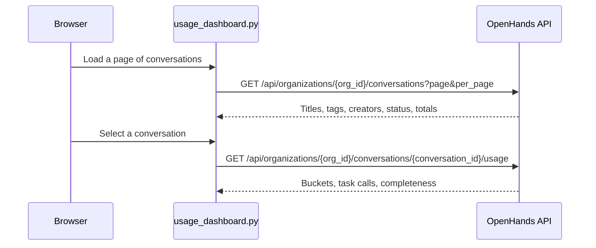

# Conversation Usage Dashboard

Run a small local web page that lists every conversation in one organization and
shows where a selected conversation's cost and tokens went: the main agent,
sub-agent tasks, the condenser, and anything else recorded. Use it to find which
parts of a run account for its usage.

The dashboard only reads. It sends `GET` requests, never changes organization
settings, and never starts, resumes, or stops a conversation.

## How It Works



- The API key stays in the Python process. The browser only talks to the
  dashboard on `127.0.0.1`.
- The list loads one page at a time. Detailed usage is fetched only for the
  conversation you select.
- Search and status filters are sent to the API. The organization list doesn't
  filter by tag, so the tag filter applies to the conversations on the loaded
  page, and the page says how many it checked.

## Prerequisites

- OpenHands Enterprise 0.110.0 or later, or OpenHands Cloud.
- An API key for an Owner or Admin of the organization. Members and service
  accounts can't list organization conversations or read detailed usage.

> [!WARNING]
> The key has all of its user's permissions, not only read access. Keep it in
> an environment variable on the machine that runs the dashboard.

## Run It

```bash
pip install requests
export OH_API_KEY=...          # Owner or Admin key
export ORG_ID=...              # the organization to show
export OH_API_BASE=https://app.all-hands.dev   # or your Enterprise URL
python usage_dashboard.py
```

```text
Dashboard: http://127.0.0.1:8501
```

Open the URL, then select a conversation to see its breakdown. Use `--port` or
`PORT` to change the port. The key is read only from `OH_API_KEY`.

## Turn On Detailed Usage

The conversation list works with the default settings. Detailed usage is off by
default, and until it is on, selecting a conversation shows:

```text
Detailed usage isn't available. It requires an Owner or Admin key, and an Owner or Admin must turn it on for the organization with PATCH /api/organizations/{org_id}.
```

The dashboard doesn't change this setting. An Owner or Admin turns it on once,
separately:

```bash
curl --fail --silent --show-error -X PATCH \
  "$OH_API_BASE/api/organizations/$ORG_ID" \
  -H "Authorization: Bearer $OH_API_KEY" \
  -H "Content-Type: application/json" \
  --data '{"enable_conversation_usage_detail": true}'
```

Set it to `false` to turn it off again. The change takes effect on the next
request; the list and totals keep working. See
[Conversation Usage Access](https://docs.openhands.dev/openhands/usage/cloud/organizations/roles-permissions#conversation-usage-access).

## Reading the Breakdown

- **Recorded total** is the conversation's stored total. Bucket values come
  from the latest usage snapshot, so they can differ from it. The dashboard
  shows both as recorded and doesn't add them up.
- **unknown** means the value wasn't recorded. `0` means it was recorded as
  zero.
- **Reasoning** tokens may already be counted in output tokens.
- **Completeness** is `full`, `partial`, or `totals_only`. When it isn't
  `full`, the `incomplete_reasons` from the API are shown, such as
  `task_usage_missing` or `no_stats_snapshot`.

The usage response doesn't include prompts, messages, task descriptions, or
tool inputs and outputs, and the dashboard doesn't request them.

## Try It With Synthetic Data

[`tests/fixture_api.py`](./tests/fixture_api.py) serves made-up data in the
same shape as the API, so you can try the page without a real organization:

```bash
python tests/fixture_api.py --port 8600 &
OH_API_KEY=synthetic-test-key ORG_ID=00000000-0000-4000-8000-0000000000aa \
  OH_API_BASE=http://127.0.0.1:8600 python usage_dashboard.py
curl "http://127.0.0.1:8600/__fixture/detail?enabled=1"   # fixture only
```

Run the tests from the repository root with `uv run pytest conversation-usage-dashboard`.

## Packaging and Agent Canvas

The dashboard is a standalone HTML and JavaScript page served by a local Python
backend. It isn't packaged or registered as an Agent Canvas extension. Embedding
it later would need authenticated access to the organization APIs from the app
server, with access controls that limit it to Owners and Admins. The Owner or
Admin key must stay on the server and never move into browser code, and hiding
a navigation item isn't authorization.

## APIs Used

| Endpoint | Purpose |
|---|---|
| `GET /api/organizations/{org_id}/conversations` | List conversations with `page`, `per_page`, `search`, and `execution_status` |
| `GET /api/organizations/{org_id}/conversations/{conversation_id}/usage` | Usage by bucket, task calls, and completeness for one conversation |

## Related

<!-- docs:cards -->

- [`conversation-metrics`](../conversation-metrics/) - Cost and token totals from the command line
- [`conversation-tags`](../conversation-tags/) - Add the tags shown in the list
- [Roles and Permissions](https://docs.openhands.dev/openhands/usage/cloud/organizations/roles-permissions) - Who can view organization conversations and usage

<!-- /docs:cards -->
