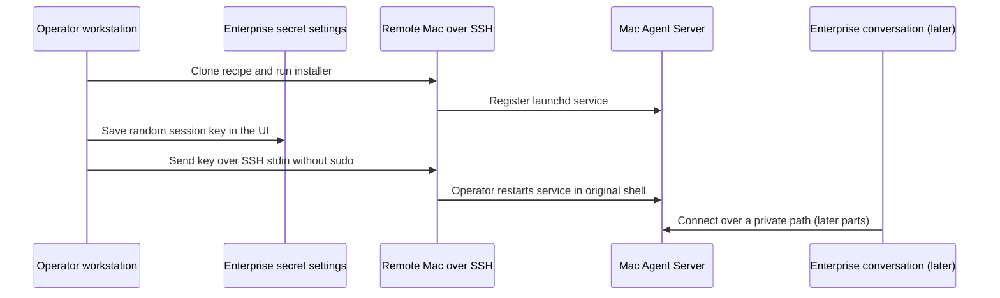

# macOS Agent Canvas Backend

Install an OpenHands Agent Server on a remote Mac from your own operator workstation. The Mac
runs a launchd service; OpenHands Enterprise retains its session key as a personal or organization
secret. Installation does **not** require an Enterprise terminal or sandbox with SSH access. The
Mac is a separate execution environment, not an Enterprise sandbox. This draft is available for a
docs preview, but has not been tested on a real Mac yet.

This first installment covers installation and key management. LLM provisioning and delegating
macOS work from Enterprise are the next installments, not working steps in this draft.

## How It Works



The installer uses an independently generated `OH_SECRET_KEY` to encrypt the Mac server's stored
secrets. The session key authenticates clients to that server; it is **not** an LLM provider key.
See the [install skill](./skills/macos-agent-server-install/SKILL.md) for an agent-facing checklist
and the [day-to-day skill](./skills/macos-agent-server-operations/SKILL.md) for management after
installation. The skills are bundled in this recipe's [plugin](./.claude-plugin/plugin.json).

## Prerequisites

- An operator workstation with SSH access to the Mac and a working login as a **non-root** macOS
  administrator. Confirm the Mac's host key outside the recipe; do not disable SSH host-key
  verification. A macOS operator workstation can use the `pbcopy`/`pbpaste` examples below.
- On the remote Mac: macOS, `git`, `curl`, `openssl`, `uv` available to the service account, and an
  admin account that can authorize `sudo`. The installer creates a Python 3.12 virtual environment.
- For first-time setup, keep the original Mac SSH shell open for an operator to authorize the
  service restart. Use a second **operator workstation** terminal for the key handoff, never the
  sudo prompt. Passwordless sudo is optional, only for later unattended rotation. Log in as the
  installed service user to change the key without privileged file access.
- Browser access to the intended OpenHands Enterprise organization and `Settings > Secrets`. A
  member can save a personal secret; saving an organization secret requires Admin/Owner access.
  No Enterprise sandbox terminal, SSH connectivity, or app API credential is needed for install.

> [!WARNING]
> The Mac agent-server runs tools on the host as the selected user, without container isolation.
> The session key grants remote shell and file access. Keep its network endpoint private, use an
> SSH tunnel or private VPN, and share an organization-scoped key only with people authorized to
> control this Mac. Do not put the key in a prompt, command arguments, Git, or a transcript.

## Run It

From a terminal on **your own workstation**, SSH into the Mac **once** as the non-root
administrator who will run the service. Verify the Mac's SSH host key before accepting it:

```bash
export MAC_SSH=admin@mac.example.net
ssh "$MAC_SSH"
```

In that **Mac shell**, run this one compound command to clone the recipe and install the server.
Until this recipe is merged, use the `macOS-agent-canvas` branch; change it to `main` after
publication. The `&&` operators stop the command if cloning or changing directories fails.
This runs the installer immediately after cloning: review the source beforehand, or split the
clone and install if you need to inspect the downloaded files. Do not pipe a script to a shell.

```bash
git clone --branch macOS-agent-canvas https://github.com/OpenHands/enterprise-cookbook.git "$HOME/enterprise-cookbook" &&
  cd "$HOME/enterprise-cookbook/macos-agent-canvas" &&
  ./oh-agent-server.sh install --host 127.0.0.1
```

`install` may prompt for the Mac administrator's sudo password. It prints the listening URL,
launchd service details and health result, **not** the session key; no separate SSH `status`
command is needed for installation. If the checkout already exists, inspect its changes and
branch, update it with `git fetch`/`git checkout`, then run `./oh-agent-server.sh install` from
`macos-agent-canvas` in the same Mac shell. Reinstalling the same user/path preserves its data and
keys unless overridden. The first install generates a temporary session key; the later key handoff
replaces it with the Enterprise-held key. Do not expose the service to a network before that
replacement. **Keep this Mac shell open**: use a second terminal on your workstation for the
next steps, and return here to restart after it sends the key. There is no third SSH login. The
key-transfer connection still requires SSH authentication; SSH key authentication can avoid a
repeated login password prompt.

A healthy status includes:

```text
ready: OK (http://127.0.0.1:18100/ready)
```

## Load the Skills

When starting the Enterprise conversation, attach this recipe as a plugin so its two skills are
available to the agent. The `ref` selects this draft branch; change it to `main` once published.
This is a field in the conversation-start request, **not** a shell command:

```json
{
  "plugins": [{
    "source": "github:OpenHands/enterprise-cookbook",
    "ref": "macOS-agent-canvas",
    "repo_path": "macos-agent-canvas"
  }]
}
```

See [`load-plugin`](../load-plugin/) for a full API example. This plugin is optional for the
operator-led install above; it does not supply SSH access. Agent-initiated service checks or later
delegation require a private route from the **calling** sandbox to the Mac. Loading a plugin in a
different conversation does not transfer SSH keys or network reachability. The install skill
covers provisioning; the operations skill covers management now and delegation after testing.

## Save the Session Key in Enterprise

In the **second terminal on your workstation** (not the Mac shell), generate a random 64-character
hex key. On a macOS workstation, copy it directly to the clipboard without printing it:

```bash
openssl rand -hex 32 | tr -d '\n' | pbcopy
```

If your workstation is not a Mac, use a trusted password manager to generate and retain a key
with at least 32 characters from `A-Z a-z 0-9 . _ ~ + / = -`, then adapt the clipboard command
in the next step. Do not put the key in a shell command, chat message, file, or transcript.

In the Enterprise **web UI**, select the intended organization, open `Settings > Secrets`, and
choose `Add a new secret`. Name it `MAC_AGENT_SERVER_KEY` and paste the clipboard value into the
**value** field (not the name or description). Leave `Share with organization` unchecked for a
personal secret; only an Admin/Owner should check it for a shared secret. Select `Add secret` and
confirm its name appears. Shared secrets are available to all members' agent runtimes in that
organization, so choose the scope deliberately and avoid duplicate names across scopes.

Enterprise settings show only the saved name and description, **not** the value. Keep the value in
your local clipboard or password manager until the Mac has accepted it and restarted. If the name
already exists, do not generate a replacement unless you intend to rotate it: the UI cannot show
the old value and requires deleting and re-adding a secret to replace its value. See
[Enterprise Secrets Management](https://docs.openhands.dev/enterprise/secrets-management) for
scope and rotation details. New conversations with access to the scope can use the stored secret
(subject to Agent Profile secret selection).

## Replace the Mac Session Key

The installer creates a temporary session API key. Replace it with the Enterprise-held key on
first setup; use the same procedure for later rotation. The new key must differ from the current
one. **Use the operator-assisted path by default**. Both paths send the key over SSH stdin, never
as a literal command argument or to a pseudo-terminal. `ssh -T` prevents terminal echo. The remote
shell reads one line as `OHAS_SESSION_API_KEY`; the installer removes it from child-process
environments and writes it to permission-restricted `config.env`.

### Operator-Assisted Setup

In the **second terminal on your workstation**, use the SSH login of the installed service user
(the same account as in the first Mac shell). Set `MAC_SSH` here too: shell variables from the
first terminal are not shared. On a macOS workstation, `pbpaste` reads the value you just saved
in Enterprise; `printf` adds a newline so the remote shell can read it. The SSH command checks
the checkout before reading the key from stdin. `--defer-restart` saves it without calling sudo.
No pseudo-terminal or sudo password prompt shares the key-transfer connection.

```bash
export MAC_SSH=admin@mac.example.net
if printf '%s\n' "$(pbpaste)" |
  ssh -T "$MAC_SSH" 'cd "$HOME/enterprise-cookbook/macos-agent-canvas" && test -x ./oh-agent-server.sh && IFS= read -r OHAS_SESSION_API_KEY && export OHAS_SESSION_API_KEY && ./oh-agent-server.sh key --reset --defer-restart'; then
  printf 'Key saved. Return to the first Mac shell to restart the service.\n'
else
  printf 'Key replacement failed; check the Mac and stored secret before retrying.\n' >&2
fi
```

**Only after the key is saved**, return to the **original Mac shell** from installation. Restart
there; the operator enters their sudo password in this shell, which never received the key:

```bash
cd "$HOME/enterprise-cookbook/macos-agent-canvas" &&
  ./oh-agent-server.sh restart &&
  ./oh-agent-server.sh status
```

The old key remains active until the restart succeeds. Do not expose the Mac's port in between.
If the restart fails after saving the key, **retry only the restart**, not `key --reset`: the
stored key and Enterprise secret already agree, but the running service may still have the old
key. When the service is stopped, use `start` rather than `restart`. After confirming the service,
clear the key from the workstation clipboard (`printf '' | pbcopy` on macOS), then run `exit` in
the Mac shell. For later rotations without an open Mac shell, open one interactive SSH login for
the restart or choose the optional unattended path below.

### Unattended Rotation (Optional)

Only if you need later automated rotation, have the Mac administrator confirm that
`/private/etc/sudoers` includes `/private/etc/sudoers.d`, then use
`sudo visudo -f /private/etc/sudoers.d/openhands-agent-server` to install a root-owned sudoers
file (mode `0440`) for the **exact** two launchctl operations below. Replace `MAC_SERVICE_USER`
with the actual SSH/service account; do not use wildcards or `NOPASSWD: ALL`:

```text
MAC_SERVICE_USER ALL=(root) NOPASSWD: /bin/launchctl print system/dev.openhands.agent-server, /bin/launchctl kickstart -k system/dev.openhands.agent-server
```

The administrator must verify the sudoers file's ownership, mode, and syntax with `visudo`; this
gives the selected user permission to inspect and restart **this** daemon, not arbitrary root
commands. It still expands what that account can do: opt in only if automation justifies it.
After a fresh login, verify the two exact rules without sending a secret or relying on cached sudo
authorization:

```bash
ssh -t "$MAC_SSH" 'sudo -k; sudo -n -l /bin/launchctl print system/dev.openhands.agent-server && sudo -n -l /bin/launchctl kickstart -k system/dev.openhands.agent-server'
```

If that check fails, use the operator-assisted path; do not weaken sudo policy. The installer
checks the same permissions before writing the key. `--unattended` does **not** call `sudo -v` and
uses `sudo -n` for its launchctl commands, so it cannot wait for a password on the secret stream.

From a macOS operator workstation, after saving the replacement value in Enterprise and
verifying the limited sudo permission, run:

```bash
if printf '%s\n' "$(pbpaste)" |
  ssh -T "$MAC_SSH" 'cd "$HOME/enterprise-cookbook/macos-agent-canvas" && IFS= read -r OHAS_SESSION_API_KEY && export OHAS_SESSION_API_KEY && ./oh-agent-server.sh key --reset --unattended'; then
  ssh "$MAC_SSH" 'cd "$HOME/enterprise-cookbook/macos-agent-canvas" && ./oh-agent-server.sh status'
else
  printf 'Key rotation failed; check the Mac and stored secret before retrying.\n' >&2
fi
```

If either path fails **before saving the key**, keep the value in your password manager or local
clipboard until Enterprise and the Mac agree. In a new conversation, refer to the stored secret by
name, `MAC_AGENT_SERVER_KEY`; never print or retrieve its value. A successful restart invalidates
the previous key for all clients. Do not generate another key without updating the stored secret.
If `--unattended` updates the key but the restart fails, fix the restart rather than resetting again.
Clear the workstation clipboard after the service is confirmed healthy.

> [!IMPORTANT]
> This recipe has not yet been exercised against a real Mac. Operator-assisted restart, limited
> sudo policy, SSH routing from the Enterprise sandbox, and macOS firewall behavior must be
> checked with the test Mac before publishing this article.

## Manage the Service

Run these from your operator workstation; each SSH command uses the Mac checkout (and a
pseudo-terminal when sudo may prompt):

```bash
ssh "$MAC_SSH" 'cd "$HOME/enterprise-cookbook/macos-agent-canvas" && ./oh-agent-server.sh status'
ssh "$MAC_SSH" 'cd "$HOME/enterprise-cookbook/macos-agent-canvas" && ./oh-agent-server.sh logs'
ssh -t "$MAC_SSH" 'cd "$HOME/enterprise-cookbook/macos-agent-canvas" && ./oh-agent-server.sh restart'
```

`start` re-enables the service at boot, `stop` disables it until a later `start`, and `restart`
restarts it. Re-running `install` upgrades packages but preserves the session key and encryption
key unless you explicitly supply `OHAS_SESSION_API_KEY`. `remove --purge` destroys the local
installation and conversations; it is **not** part of routine management. Avoid `key` without
`--reset` or `--copy`: it displays the credential in the transcript.

The default directory is the service user's `~/.openhands-agent-server` (venv, logs, data,
`config.env`). The directory is mode `700`; `config.env` is mode `600`. Use `--user USER` and an
optional absolute `OHAS_HOME` for a different existing account, but changing users does not migrate
keys or conversations. The installer defaults to latest PyPI release and accepts `--ref` for a Git
ref. It can also bind `0.0.0.0` for a **private** network, but its listed interface URLs do not
prove reachability and macOS's firewall can block it. The status and start commands do not print
the key.

## Next Parts

1. **LLM profile:** Check that BYOR key export is permitted in Enterprise, discover models served
   by its LiteLLM proxy, ensure the proxy endpoint is reachable from the Mac, then create and
   activate a Mac Agent Server LLM profile using its profile API. The Enterprise app API key,
   LiteLLM BYOR key, and Mac session key are different credentials.
2. **Delegate macOS work:** Give an Enterprise conversation a stable, private route to the Mac,
   then start and monitor Mac Agent Server conversations using the [operations skill](./skills/macos-agent-server-operations/SKILL.md).
   A `127.0.0.1`-bound install requires an SSH tunnel in the **calling** environment; localhost
   in the Enterprise sandbox is not localhost on the Mac. Do not expose the authenticated
   `/api/*` endpoint directly to the public internet.

## APIs Used

| Endpoint | Purpose |
|---|---|
| `POST /api/v1/secrets` on Enterprise | Save a personal session key |
| `POST /api/organizations/{org_id}/secrets` on Enterprise | Save a shared session key (Admin/Owner) |
| `GET /ready` on the Mac | Check the Agent Server process (not authentication or LLM readiness) |

## Related

<!-- docs:cards -->

- [Enterprise Secrets Management](https://docs.openhands.dev/enterprise/secrets-management) - Secret scopes and permissions
- [Remote Backend](https://docs.openhands.dev/openhands/usage/agent-canvas/backend-setup/remote) - Connect to a separate Agent Server
- [Configure a Model](https://docs.openhands.dev/openhands/usage/agent-canvas/model-configuration) - Set up an LLM profile later
- [`aws-secrets-sync`](../aws-secrets-sync/) - Another example of personal and organization secrets

<!-- /docs:cards -->
