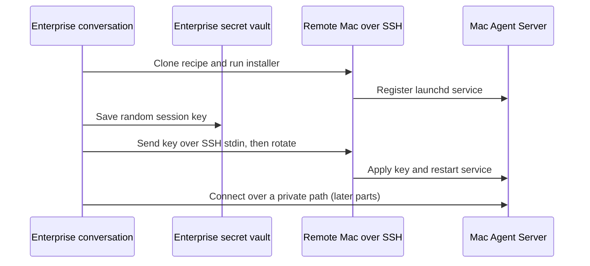

# macOS Agent Canvas Backend

Install an OpenHands Agent Server on a remote Mac from an OpenHands Enterprise conversation. The
Mac runs a launchd service; Enterprise supplies the SSH connection and retains its session key as a
personal or organization secret. The Mac is a separate execution environment, not an Enterprise
sandbox. This draft is available for a docs preview, but has not been tested on a real Mac yet.

This first installment covers installation and key management. LLM provisioning and delegating
macOS work from Enterprise are the next installments, not working steps in this draft.

## How It Works



The installer uses an independently generated `OH_SECRET_KEY` to encrypt the Mac server's stored
secrets. The session key authenticates clients to that server; it is **not** an LLM provider key.
See the [install skill](./skills/macos-agent-server-install/SKILL.md) for an agent-facing checklist
and the [day-to-day skill](./skills/macos-agent-server-operations/SKILL.md) for management after
installation. The skills are bundled in this recipe's [plugin](./.claude-plugin/plugin.json).

## Prerequisites

- An OpenHands Enterprise conversation with terminal access, SSH connectivity to the Mac, and a
  working SSH login as a **non-root** macOS administrator. Confirm the Mac's host key outside the
  recipe; do not disable SSH host-key verification.
- On the Mac: macOS, `git`, `curl`, `openssl`, `uv` available to the service account, and an admin
  account that can authorize `sudo`. The installer creates a Python 3.12 virtual environment.
- For unattended **remote key rotation**, `ssh -T "$MAC_SSH" 'sudo -n -v'` must succeed. If it does
  not, stop before sending the key; arrange an operator-assisted rotation rather than piping a
  sudo password and a secret into one session. Installation itself uses an interactive `sudo` prompt.
- An Enterprise organization selected for the conversation and a human user's Enterprise app API
  credential available as `OH_API_KEY` in that conversation's terminal (store it as a secret; do
  not paste it into chat). To save a *personal* secret, use your own API key; to save an
  *organization* secret, use an Admin/Owner API key for that organization. The Enterprise app API
  key is distinct from the Mac session key.

> [!WARNING]
> The Mac agent-server runs tools on the host as the selected user, without container isolation.
> The session key grants remote shell and file access. Keep its network endpoint private, use an
> SSH tunnel or private VPN, and share an organization-scoped key only with people authorized to
> control this Mac. Do not put the key in a prompt, command arguments, Git, or a transcript.

## Run It

Set `MAC_SSH` to the remote SSH login. Clone the cookbook **on the Mac** and install from that
checkout. Until this recipe is merged, use the `macOS-agent-canvas` branch; change the branch to
`main` after publication. Never run an uninspected `curl | sh` installer.

```bash
export MAC_SSH=admin@mac.example.net
ssh "$MAC_SSH" 'uname -s; id -un; command -v git; command -v uv'
ssh "$MAC_SSH" 'git clone --branch macOS-agent-canvas https://github.com/OpenHands/enterprise-cookbook.git "$HOME/enterprise-cookbook"'
ssh -t "$MAC_SSH" 'cd "$HOME/enterprise-cookbook/macos-agent-canvas" && ./oh-agent-server.sh install --host 127.0.0.1'
ssh "$MAC_SSH" 'cd "$HOME/enterprise-cookbook/macos-agent-canvas" && ./oh-agent-server.sh status'
```

`install` may prompt for the remote administrator's sudo password. It prints the listening URL,
launchd service details and health result, **not** the session key. For a Mac that already has
this checkout, run `git -C "$HOME/enterprise-cookbook" fetch` and check the desired branch before
reinstalling; reinstalling the same user/path preserves its data and keys unless overridden. The
first install generates a temporary session key; the next step replaces it with the Enterprise-held
key. Do not expose the service to a network before that rotation.

A healthy status includes:

```text
ready: OK (http://127.0.0.1:18100/ready)
```

## Load the Skills

When starting the Enterprise conversation, attach this recipe as a plugin so its two skills are
available to the agent. The `ref` selects this draft branch; change it to `main` once published.
This is a field in the conversation-start request, **not** a shell command:

```json
{
  "plugins": [{
    "source": "github:OpenHands/enterprise-cookbook",
    "ref": "macOS-agent-canvas",
    "repo_path": "macos-agent-canvas"
  }]
}
```

See [`load-plugin`](../load-plugin/) for a full API example. Start in a sandbox that can SSH to
the Mac; loading a plugin in a **different** conversation does not transfer the existing sandbox's
SSH keys or network reachability. The install skill is for provisioning; the operations skill is
for service checks now and task delegation once the later parts are tested.

## Save the Session Key in Enterprise

Generate one random 64-character hex key in the **Enterprise conversation**; the installer accepts
32 or more characters from `A-Z a-z 0-9 . _ ~ + / = -`. Choose one scope and a unique name. The
examples use `MAC_AGENT_SERVER_KEY`; avoid creating personal and shared secrets with the same name.
If a Mac already has a stored key, reuse it rather than generating a new one unless you intend to
rotate. Do not print the generated value.

```bash
export MAC_AGENT_SERVER_KEY="$(openssl rand -hex 32)"
```

<!-- docs:tabs -->

### Personal Secret

Use your **human user's** Enterprise API credential and deployment URL. Sending JSON on stdin
keeps the secret out of the `curl` command arguments. The response contains a status message,
not the value.

```bash
export OH_API_BASE=https://app.enterprise.example.com
python3 -c 'import json, os; print(json.dumps({"name": "MAC_AGENT_SERVER_KEY", "value": os.environ["MAC_AGENT_SERVER_KEY"], "description": "Remote Mac Agent Server session key"}))' |
  curl -fsS -X POST "$OH_API_BASE/api/v1/secrets" \
    -H "Authorization: Bearer $OH_API_KEY" -H 'Content-Type: application/json' \
    --data-binary @-
```

### Organization Secret

Run as an Admin/Owner in the intended organization and use its ID, not a personal organization's
ID by accident. Shared secrets are available to **all** members' agent runtimes in that org.

```bash
export OH_API_BASE=https://app.enterprise.example.com
export ORG_ID=YOUR_ORGANIZATION_UUID
python3 -c 'import json, os; print(json.dumps({"name": "MAC_AGENT_SERVER_KEY", "value": os.environ["MAC_AGENT_SERVER_KEY"], "description": "Remote Mac Agent Server session key"}))' |
  curl -fsS -X POST "$OH_API_BASE/api/organizations/$ORG_ID/secrets" \
    -H "Authorization: Bearer $OH_API_KEY" -H 'Content-Type: application/json' \
    --data-binary @-
```

<!-- /docs:tabs -->

Enterprise secret settings and listing APIs do **not** return saved values. Once stored, a secret
is available by name in **new** conversations with access to that scope (subject to Agent Profile
secret selection). In the current Enterprise terminal, keep the generated variable until the Mac
rotation succeeds. See [Enterprise Secrets Management](https://docs.openhands.dev/enterprise/secrets-management)
for permissions and the difference between personal and shared scopes.

## Rotate the Mac Key

First verify **non-interactive** sudo and the target checkout, without sending a secret. The
installer's `key --reset` needs sudo to restart launchd and refuses a replacement identical to the
current key.

```bash
ssh -T "$MAC_SSH" 'sudo -n -v && test -x "$HOME/enterprise-cookbook/macos-agent-canvas/oh-agent-server.sh"'
```

Only after that succeeds, send the key over SSH **stdin**, not in a shell argument, command line,
file, or URL. `ssh -T` disables a pseudo-terminal so the secret cannot be echoed by terminal line
discipline. The remote shell reads one line, passes it as `OHAS_SESSION_API_KEY` to the installer,
and the installer removes it from child-process environments. The script stores it in its
permission-restricted `config.env` and restarts the server if running.

```bash
if printf '%s\n' "$MAC_AGENT_SERVER_KEY" |
  ssh -T "$MAC_SSH" 'sudo -n -v && cd "$HOME/enterprise-cookbook/macos-agent-canvas" && IFS= read -r OHAS_SESSION_API_KEY && export OHAS_SESSION_API_KEY && ./oh-agent-server.sh key --reset'; then
  unset MAC_AGENT_SERVER_KEY
  ssh "$MAC_SSH" 'cd "$HOME/enterprise-cookbook/macos-agent-canvas" && ./oh-agent-server.sh status'
else
  printf 'Key rotation failed; check the Mac and stored secret before retrying.\n' >&2
fi
```

If rotation fails, **do not unset the new key until the Mac and Enterprise secret agree**. In a
new conversation, refer to the secret name `MAC_AGENT_SERVER_KEY` to have Enterprise inject its
value; do not retrieve it through a display/`echo` command. A reset invalidates the previous key
for all clients. Do not call `key --reset` twice with different generated keys unless you also
update the stored secret. When service is stopped, reset updates the key but leaves it stopped.

> [!IMPORTANT]
> The recipe has not yet been exercised against a real Mac. In particular, interactive sudo for
> `install`, non-interactive sudo for `key --reset`, SSH routing from the Enterprise sandbox, and
> macOS firewall behavior must be checked with the test Mac before publishing this article.

## Manage the Service

Run these from the same Mac checkout (interactively over SSH when sudo prompts are needed):

```bash
ssh "$MAC_SSH" 'cd "$HOME/enterprise-cookbook/macos-agent-canvas" && ./oh-agent-server.sh status'
ssh "$MAC_SSH" 'cd "$HOME/enterprise-cookbook/macos-agent-canvas" && ./oh-agent-server.sh logs'
ssh -t "$MAC_SSH" 'cd "$HOME/enterprise-cookbook/macos-agent-canvas" && ./oh-agent-server.sh restart'
```

`start` re-enables the service at boot, `stop` disables it until a later `start`, and `restart`
restarts it. Re-running `install` upgrades packages but preserves the session key and encryption
key unless you explicitly supply `OHAS_SESSION_API_KEY`. `remove --purge` destroys the local
installation and conversations; it is **not** part of routine management. Avoid `key` without
`--reset` or `--copy`: it displays the credential in the transcript.

The default directory is the service user's `~/.openhands-agent-server` (venv, logs, data,
`config.env`). The directory is mode `700`; `config.env` is mode `600`. Use `--user USER` and an
optional absolute `OHAS_HOME` for a different existing account, but changing users does not migrate
keys or conversations. The installer defaults to latest PyPI release and accepts `--ref` for a Git
ref. It can also bind `0.0.0.0` for a **private** network, but its listed interface URLs do not
prove reachability and macOS's firewall can block it. The status and start commands do not print
the key.

## Next Parts

1. **LLM profile:** Check that BYOR key export is permitted in Enterprise, discover models served
   by its LiteLLM proxy, ensure the proxy endpoint is reachable from the Mac, then create and
   activate a Mac Agent Server LLM profile using its profile API. The Enterprise app API key,
   LiteLLM BYOR key, and Mac session key are different credentials.
2. **Delegate macOS work:** Give an Enterprise conversation a stable, private route to the Mac,
   then start and monitor Mac Agent Server conversations using the [operations skill](./skills/macos-agent-server-operations/SKILL.md).
   A `127.0.0.1`-bound install requires an SSH tunnel in the **calling** environment; localhost
   in the Enterprise sandbox is not localhost on the Mac. Do not expose the authenticated
   `/api/*` endpoint directly to the public internet.

## APIs Used

| Endpoint | Purpose |
|---|---|
| `POST /api/v1/secrets` on Enterprise | Save a personal session key |
| `POST /api/organizations/{org_id}/secrets` on Enterprise | Save a shared session key (Admin/Owner) |
| `GET /ready` on the Mac | Check the Agent Server process (not authentication or LLM readiness) |

## Related

<!-- docs:cards -->

- [Enterprise Secrets Management](https://docs.openhands.dev/enterprise/secrets-management) - Secret scopes and permissions
- [Remote Backend](https://docs.openhands.dev/openhands/usage/agent-canvas/backend-setup/remote) - Connect to a separate Agent Server
- [Configure a Model](https://docs.openhands.dev/openhands/usage/agent-canvas/model-configuration) - Set up an LLM profile later
- [`aws-secrets-sync`](../aws-secrets-sync/) - Another example of personal and organization secrets

<!-- /docs:cards -->
