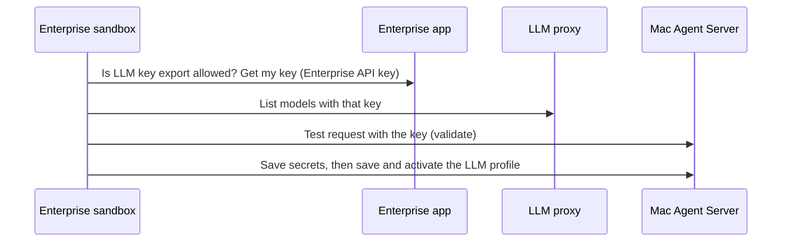

# macOS Agent Server from OpenHands Enterprise

An operator installs OpenHands Agent Server on a Mac over SSH from their own workstation,
behind a TLS front end. After installation, an OpenHands Enterprise conversation calls the
Mac's Agent Server REST API over HTTPS from its sandbox, using a session key and the Mac's
certificate saved in Enterprise `Settings > Secrets`. Enterprise does **not** SSH to the Mac or
receive the operator's SSH credentials. The Mac is a separate host, not an Enterprise sandbox.
Automated tests and a real launchd install, authenticated local/LAN TLS, stop/start,
reinstall, source allow-list, and purge have passed on macOS 15.6.1 (arm64). The Mac's
application firewall was disabled during testing. Reboot persistence, LLM/secrets sync,
and the Enterprise sandbox-to-Mac path remain unverified.

> [!WARNING]
> **The session key is all it takes to run commands on the Mac as its service user.** HTTPS
> keeps the key, requests, and responses from being read or changed on the network, and the
> sandbox trusts only this Mac's own certificate. It does not limit who can try the key, so
> also limit which networks can reach the TLS port (`--allow-from` and the firewall), and
> consider a dedicated service account. Showing the key in the operator's terminal exposes it
> to terminal scrollback, screen sharing, and recordings.

## How It Works

```mermaid
sequenceDiagram
    participant O as Operator workstation
    participant M as Mac over operator SSH
    participant V as Enterprise secret settings
    participant E as Enterprise sandbox
    participant T as TLS front end on the Mac (port 18443)
    participant A as Agent Server on the Mac (127.0.0.1:18100)
    O->>M: install --tls-name (authorize sudo)
    M->>A: Register launchd services; generate session key and certificate
    O->>V: Paste session key and certificate into Settings > Secrets
    E->>T: HTTPS request with key header; only the saved certificate is trusted
    T->>A: The same bytes over loopback
    E->>T: Copy LLM profile and chosen secrets (sync_llm.py)
```

The Agent Server speaks plain HTTP, and calls itself over plain HTTP on loopback, so it cannot
terminate TLS itself. The installer binds it to `127.0.0.1` and runs
[`tls_front.py`](./tls_front.py), a small TLS tunnel built on the Python standard library, as a
second launchd service on a network port. It copies bytes in both directions without parsing
them, so REST calls and WebSockets both work.

The installer also generates an independent `OH_SECRET_KEY` to encrypt the Mac server's stored
secrets. The session key authenticates HTTP clients; it is **not** an LLM provider key or an SSH
key. See the [install skill](./skills/macos-agent-server-install/SKILL.md) for the agent-facing
checklist, the [LLM setup skill](./skills/macos-agent-server-llm-setup/SKILL.md) for giving the
Mac an LLM and secrets, and the [operations skill](./skills/macos-agent-server-operations/SKILL.md)
for later management. All three are bundled in this recipe's
[plugin](./.claude-plugin/plugin.json).

## Prerequisites

- The operator has a working SSH login as a **non-root macOS administrator** and can authorize
  `sudo`. Verify the Mac's SSH host key before accepting it. These credentials remain with the
  operator, never in Enterprise Secrets or an agent conversation.
- The Mac has `git`, `curl`, `openssl`, and `uv` available to the service account. The installer
  creates a Python 3.12 virtual environment. By default, the service runs as the installing
  account; for a dedicated non-admin service account, provision its home and `uv` first and
  pass `--user ACCOUNT` to the installer. That account's files and processes will be available
  to anyone with the session key. The operator still runs the installer and authorizes sudo.
- Choose the **host name or IP address that Enterprise sandboxes use to reach the Mac**. The
  installer issues the certificate for that name, and clients refuse any other name. It must
  resolve from the sandboxes.
- The customer's firewall must allow TCP port `18443` (the TLS port) **only from the intended
  Enterprise sandbox network**, and nothing else needs to reach the Mac. Verify that sandbox
  egress and the Mac's application firewall permit the connection. SSH is needed only between
  the operator workstation and Mac; successful operator SSH does not establish
  sandbox-to-Mac reachability. Do not expose the API on the public internet.
- The operator has Enterprise browser access to the intended organization and
  `Settings > Secrets`. A member can save a personal secret; an Admin/Owner is required for an
  organization-shared secret. A new conversation must have the secrets in its scope and, if
  applicable, selected by its Agent Profile.

## Install on the Mac

From a terminal on **your own workstation**, SSH into the Mac as the administrator. Verify its
SSH host key before accepting it:

```bash
export MAC_SSH=admin@mac.example.net
ssh "$MAC_SSH"
```

In that **Mac shell**, clone the recipe and install the server. Until this recipe is merged,
use the `macOS-agent-canvas` branch; change it to `main` after publication. Review the source
beforehand, or separate the clone and install to inspect the downloaded files. The `&&`
operators stop the install if an earlier command fails. Do not pipe a downloaded script to a
shell. Replace `mac.internal.example` with the name sandboxes use for this Mac:

```bash
git clone --branch macOS-agent-canvas https://github.com/OpenHands/enterprise-cookbook.git "$HOME/enterprise-cookbook" &&
  cd "$HOME/enterprise-cookbook/macos-agent-canvas" &&
  ./oh-agent-server.sh install --tls-name mac.internal.example
```

The script runs as the **operator**, not root, and prompts for the Mac administrator's sudo
password when registering or starting the launchd services. It:

1. installs the Agent Server in `~/.openhands-enterprise-mac-agent` and binds it to `127.0.0.1:18100`;
2. creates a session key and an independent encryption key, **without printing either**;
3. creates a self-signed certificate for the name you gave, valid for about 825 days, and
   keeps the private key on the Mac with mode `600`;
4. registers the Agent Server and the TLS front end (port `18443`) as launchd services that
   start at boot, and waits until both answer.

```text
==> Installed and running
==> Starting the TLS front end

  Agent Server: https://mac.internal.example:18443 (TLS front end)
  Plain HTTP:   http://127.0.0.1:18100 (this Mac only)
  Certificate:  names=mac.internal.example,localhost,127.0.0.1 expires=2029-02-13 days_left=825 fingerprint=SHA256:…
  Allowed from: any source address
```

Options you can add to the install command:

| Option | Effect |
|---|---|
| `--allow-from CIDR[,CIDR…]` | The TLS front end accepts connections only from these networks, in addition to your firewall. The Mac sees the address the sandbox's traffic leaves your network from, which may be a NAT gateway. |
| `--tls-port N` | Use a different TLS port (default `18443`). |
| `--user ACCOUNT` | Run as an existing dedicated service account. Verify `uv` is available to it first. |
| `--no-tls` | Remove the TLS front end. The Agent Server stays on `127.0.0.1`; add `--host 0.0.0.0` for a plain-HTTP network bind, which this recipe does not support. |

Reinstalling with the same user and path keeps the keys, ports, TLS settings, and the
certificate unless you override them, so the saved secrets stay valid. If this checkout already
exists, inspect its branch and changes, update it with `git fetch` / `git checkout`, and install
from `macOS-agent-canvas`.

> [!NOTE]
> Already have a reverse proxy or load balancer with a certificate your sandboxes trust? Skip
> `--tls-name` and run `./oh-agent-server.sh install --host 127.0.0.1`, then point the proxy at
> `127.0.0.1:18100`. Use the proxy's address as the target below. You need
> `MAC_AGENT_SERVER_CA` only if the proxy's certificate comes from a private CA.

Check the install from the same Mac shell. The installer already waits for both services;
`status` shows them, the certificate's expiry, and a pinned HTTPS check, and exits non-zero if
the Agent Server or the TLS front end does not answer:

```bash
./oh-agent-server.sh status
curl -fsS --max-time 3 http://127.0.0.1:18100/ready
```

A successful `/ready` response confirms the process, **not** API authentication, network
reachability from an Enterprise sandbox, or a configured LLM.

## Save the Session Key and Certificate in Enterprise

In the **Mac shell on the operator workstation**, deliberately display the generated key once:

```bash
./oh-agent-server.sh key
```

The key appears in that terminal's output. Copy it directly into the Enterprise **web UI**:
select the intended organization, open `Settings > Secrets`, choose `Add a new secret`, name it
`MAC_AGENT_SERVER_KEY`, and paste the value into the **value** field. For a personal secret,
leave `Share with organization` unchecked; only an Admin/Owner should check it when every member
of that organization is authorized to control the Mac. Confirm the secret name appears.
Do not paste the key into chat, a command argument, a URL, Git, or an agent transcript. Prevent
terminal recording or screen sharing while displaying it; clear the workstation clipboard and
terminal scrollback when finished. Enterprise settings will not show the stored value again.
(`key --copy` copies to the clipboard **of the Mac**, which helps only when you are at the Mac.)

Then save the certificate the same way, as `MAC_AGENT_SERVER_CA`, with the same scope:

```bash
./oh-agent-server.sh ca
```

```text
LS0tLS1CRUdJTiBDRVJUSUZJQ0FURS0tLS0tCk1JSUJ…
```

This prints the public certificate as **one line of base64**, because the secret form is a
single-line field. The certificate is not secret, but saving it as a secret makes it available
to the sandbox without putting it in a prompt. `install` and `status` print the certificate's
fingerprint, and `./oh-agent-server.sh ca --pem` shows the PEM text, if you want to inspect it.

If either secret name already exists, **stop**: do not overwrite the Mac key or create a second
value unintentionally. Replacing a saved value in the UI requires deleting and re-adding that
secret, and existing conversations may retain an older value. Key rotation is outside this
first-install flow. See [Enterprise Secrets Management](https://docs.openhands.dev/enterprise/secrets-management)
for scope and rotation details. Once the values are saved, the operator may exit the Mac SSH
shell; no Enterprise SSH credential is needed.

## Verify from an Enterprise Sandbox

Start a **new** Enterprise conversation in the organization with access to both secrets. If
using this recipe as a plugin, include the following `plugins` field in the
conversation-start request; this is JSON for the request, **not** a shell command:

```json
{
  "plugins": [{
    "source": "github:OpenHands/enterprise-cookbook",
    "ref": "macOS-agent-canvas",
    "repo_path": "macos-agent-canvas"
  }]
}
```

See [`load-plugin`](../load-plugin/) for a full conversation-start example. Plugins provide
instructions, not credentials or network access. In the **Enterprise sandbox's terminal**,
replace `mac.internal.example` with the name you gave the installer and run this **read-only,
authenticated** REST check. The secrets are exported into the command environment when
referenced by name; neither the command nor its output displays their values. `curl` trusts
only the certificate you saved:

```bash
curl -fsS --max-time 10 --output /dev/null \
  --cacert <(printf '%s' "$MAC_AGENT_SERVER_CA" | base64 -d) \
  -H "X-Session-API-Key: $MAC_AGENT_SERVER_KEY" \
  'https://mac.internal.example:18443/api/settings' &&
  printf 'Authenticated Mac Agent Server API is reachable.\n'
```

`/api/settings` requires the session key; suppressing its response avoids displaying settings
in the transcript. If this fails, stop and check the name (`curl: (60)` or `SSL: no alternative
certificate subject name` means it differs from the certificate's), the firewall and
`--allow-from`, sandbox egress, secret scope, and Agent Profile selection. Do not paste the key
into chat to debug it. A successful request proves this sandbox can authenticate to this API,
**not** that the Mac has an LLM profile or can run an agent conversation.

> [!IMPORTANT]
> On macOS 15.6.1, both launchd services ran and authenticated REST worked locally and via
> the Mac's private LAN address. The application firewall was off; a client on a second
> machine, enabled-firewall behavior, and Enterprise sandbox egress have **not** been tested.
> Verify those paths in your own network before relying on this installation for Enterprise.

## Give the Mac an LLM and Secrets

The Mac Agent Server has no LLM until you give it one. The `sync_llm.py` script, bundled in the
[LLM setup skill](./skills/macos-agent-server-llm-setup/SKILL.md), runs in an Enterprise
conversation and copies your LLM access and the secrets you choose to the Mac. You never see or
paste the LLM key.



**Before you start:**

- An Enterprise administrator turns on **Enable LLM Key Export (BYOR)** in the Replicated Admin
  Console. It is off by default because it lets users take their LLM key out of the cluster.
  The script stops with that instruction when it is off.
- The Mac can reach the LLM proxy at `https://llm-proxy.<your base domain>`, the LLM Proxy
  Hostname shown in the Admin Console. A Replicated installation publishes it with a
  certificate. This recipe covers Replicated VM installations only.
- The secrets you want on the Mac are saved in Enterprise `Settings > Secrets` and are in the
  conversation's scope.

Start a new conversation with the plugin loaded, as in the previous section, and ask the agent
to give the Mac an LLM. Its steps are these commands, run from the plugin's skill directory. The
key and certificate names must appear in the command so the sandbox injects them:

```bash
python3 scripts/sync_llm.py --target https://mac.internal.example:18443 \
  --api-key-env OPENHANDS_API_KEY --target-key-env MAC_AGENT_SERVER_KEY \
  --ca-cert-env MAC_AGENT_SERVER_CA --list-models
python3 scripts/sync_llm.py --target https://mac.internal.example:18443 \
  --api-key-env OPENHANDS_API_KEY --target-key-env MAC_AGENT_SERVER_KEY \
  --ca-cert-env MAC_AGENT_SERVER_CA \
  --model claude-sonnet-4-5 --secret GITHUB_TOKEN --dry-run
```

Run the second command without `--dry-run` to apply it. It prints the steps, never a value:

```text
ok   LLM key export is allowed
ok   Mac Agent Server reachable at https://mac.internal.example:18443
ok   the key works at https://llm-proxy.example.com
ok   the Mac completed a test request through the proxy
ok   saved 1 secret(s) on the Mac
ok   LLM profile 'enterprise' saved and active on the Mac
```

The Mac checks the key before anything is saved, so a bad key or unreachable proxy changes
nothing. The script verifies the Mac's certificate against `MAC_AGENT_SERVER_CA` only, and it
refuses a plain `http://` target unless you pass `--allow-insecure-http`, which you should not
need. If you refresh your key in Settings, or the installation resets its LLM proxy database,
the Mac's copy stops working. Run the script with `--check` to find out, and run it again
without `--check` to fix it. Pass `--enterprise-url` or `--llm-base-url` if the installation
uses custom hostnames.

> [!IMPORTANT]
> The script's tests use local stand-ins. It has also run end to end against OpenHands Cloud
> (LLM key export, the public LLM proxy) and a real Agent Server behind this recipe's TLS front
> end on Linux. It has not run against a Replicated VM installation or a Mac. Run it once there,
> with LLM key export turned on, before relying on it.

## Manage the Service

Run these from your operator workstation; each SSH command uses the Mac checkout (and a
pseudo-terminal when sudo may prompt):

```bash
ssh "$MAC_SSH" 'cd "$HOME/enterprise-cookbook/macos-agent-canvas" && ./oh-agent-server.sh status'
ssh "$MAC_SSH" 'cd "$HOME/enterprise-cookbook/macos-agent-canvas" && ./oh-agent-server.sh logs'
ssh "$MAC_SSH" 'cd "$HOME/enterprise-cookbook/macos-agent-canvas" && ./oh-agent-server.sh logs --tls'
ssh -t "$MAC_SSH" 'cd "$HOME/enterprise-cookbook/macos-agent-canvas" && ./oh-agent-server.sh restart'
```

`start`, `stop`, and `restart` act on both services. `start` re-enables startup at boot, `stop`
disables it until a later `start`, and `restart` preserves the key. `logs` shows the Agent
Server's log and `logs --tls` the TLS front end's. `remove --purge` destroys the installation,
certificate, and conversations; it is not routine management. `key` displays the credential, so
use it only in a private operator terminal. The default directory is the service user's
`~/.openhands-enterprise-mac-agent` (virtual environment, logs, data, `tls/`,
`config.env`). The launchd wrapper sets `OH_PERSISTENCE_DIR` to this directory's `state/`
for profiles, settings, and secrets; it also keeps conversations, the default workspace,
and worktrees under `data/`. These are separate from the SDK's shared `~/.openhands`.
The install directory and `state/` are mode `700`; `config.env` and the certificate's
private key are mode `600`. `remove --purge` refuses directories not recognized as this
recipe's installations. Changing service users does not migrate keys, certificates,
or conversations. Existing installations are found from their launchd plist and retain
their old directory when upgraded; profiles previously saved in the shared
`~/.openhands` are not automatically moved into the isolated `state/`.

### Certificate Renewal

The certificate is valid for about 825 days. `status` prints the days left. Re-running
`./oh-agent-server.sh install --tls-name NAME` keeps the certificate while it covers `NAME` and
has more than 30 days left, and replaces it otherwise. A replaced certificate has a new
fingerprint, so save the new `./oh-agent-server.sh ca` output in Enterprise afterwards, by
deleting and re-adding the `MAC_AGENT_SERVER_CA` secret. To replace it sooner, delete the
`tls/` directory in the install directory first.

## Later Work

1. **Delegate macOS work:** Start and monitor Mac Agent Server conversations with authenticated
   REST requests from the Enterprise sandbox after validating the LLM profile and the host's
   tool permissions. No Enterprise SSH access is part of this flow.
2. **Hardening:** Rotate the session key without re-pasting by hand, add certificates from a
   private CA instead of a self-signed one, and test reboot persistence, the enabled macOS
   application firewall, dedicated service users, and a Replicated VM.

## APIs Used

| Endpoint | Purpose |
|---|---|
| `GET /ready` on the Mac (`http://127.0.0.1:18100`) | Unauthenticated process check |
| `GET /api/settings` on the Mac (HTTPS) | Read-only authenticated REST connectivity check |
| `GET /api/keys/llm/byor/permitted` and `GET /api/keys/llm/byor` on Enterprise | Check that LLM key export is on, then get the user's key |
| `GET /v1/models` on the LLM proxy | List the models the key can use |
| `POST /api/profiles/{name}/validate`, `POST /api/profiles/{name}`, `POST /api/profiles/{name}/activate` on the Mac | Test, save, and activate the LLM profile |
| `PUT /api/settings/secrets` on the Mac | Save a copied secret |
| `GET /api/profiles/{name}` on the Mac | Read the stored profile for `--check` |

The operator saves the key and certificate via Enterprise `Settings > Secrets`, not an
Enterprise API call.

## Related

<!-- docs:cards -->

- [Enterprise Secrets Management](https://docs.openhands.dev/enterprise/secrets-management) - Secret scopes and permissions
- [Agent Server Overview](https://docs.openhands.dev/sdk/guides/agent-server/overview) - The Mac's HTTP REST service
- [`aws-secrets-sync`](../aws-secrets-sync/) - Another example of personal and organization secrets

<!-- /docs:cards -->
